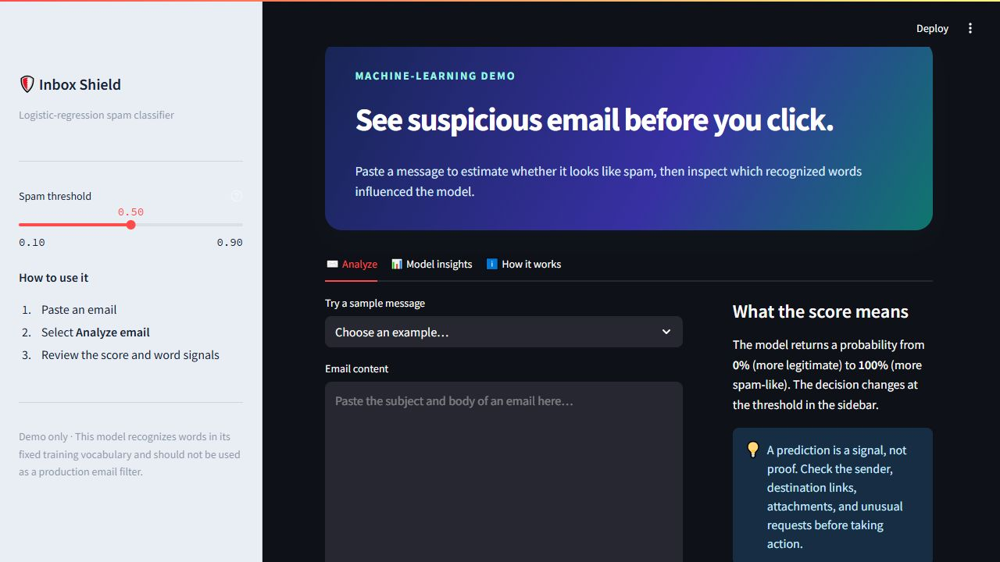
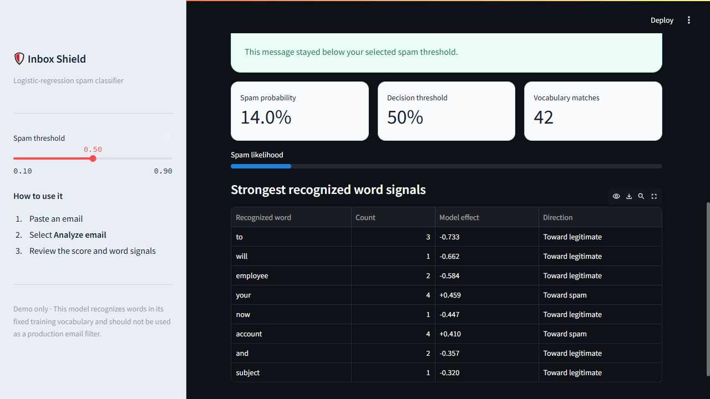

# Inbox Shield: Spam Detection Model

Inbox Shield is an educational machine-learning project that classifies email as
**spam** or **legitimate** with logistic regression. The repository includes the
training dataset, a reproducible training script, a saved model artifact, and an
interactive Streamlit interface that explains each prediction.

> [!IMPORTANT]
> This is a portfolio and learning project, not a production security product.
> Never use its result as the only reason to trust a sender, open an attachment,
> follow a link, or provide personal information.



## What the project demonstrates

- Training a binary classifier from 3,000 numeric word-occurrence features
- Evaluating a classifier with accuracy, precision, recall, F1 score, and a
  confusion matrix
- Persisting a trained scikit-learn estimator with Joblib
- Converting pasted email text into the feature layout expected by the model
- Presenting probability, threshold, vocabulary coverage, and feature
  contributions in a Streamlit UI
- Explaining where a simple bag-of-words model works and where it can fail

## Repository contents

```text
Spam_Detection_Model/
|-- app.py                              # Streamlit interface
|-- spam_detect.py                      # Training and evaluation script
|-- spam_detection_pipeline.joblib      # Saved logistic-regression estimator
|-- spam_data.csv                       # Training features and labels
|-- requirements.txt                    # Python dependencies
|-- docs/
|   `-- images/
|       |-- inbox-shield-analyze.png    # Analyzer screenshot
|       `-- inbox-shield-result.png     # Prediction explanation screenshot
|-- LICENSE
`-- README.md
```

## Dataset

The included `spam_data.csv` contains 5,172 rows and 3,002 columns:

| Field | Description |
| --- | --- |
| `Email No.` | Text identifier such as `Email 1`; excluded from training |
| 3,000 word columns | Numeric occurrence counts for words such as `the`, `you`, and `free` |
| `Prediction` | Binary label: `0` = legitimate, `1` = spam |

Class distribution:

| Class | Rows | Approximate share |
| --- | ---: | ---: |
| Legitimate | 3,672 | 71% |
| Spam | 1,500 | 29% |
| **Total** | **5,172** | **100%** |

Because the classes are imbalanced, accuracy should always be interpreted with
precision, recall, F1 score, and the confusion matrix.

## Quick start

### 1. Create a virtual environment

Python 3.9 or later is recommended.

```bash
python -m venv .venv
```

Activate it on Windows PowerShell:

```powershell
.\.venv\Scripts\Activate.ps1
```

Activate it on macOS or Linux:

```bash
source .venv/bin/activate
```

### 2. Install dependencies

```bash
python -m pip install --upgrade pip
python -m pip install -r requirements.txt
```

### 3. Start the Streamlit interface

From the repository root, run:

```bash
streamlit run app.py
```

Streamlit normally opens `http://localhost:8501` in the default browser. Keep
`spam_data.csv` and `spam_detection_pipeline.joblib` beside `app.py` because the
application reads both at startup.

## Using the interface

1. Set the **Spam threshold** in the sidebar. Start with the default `0.50`.
2. Select a built-in example or paste a complete email into **Email content**.
   Including the subject and body gives the model more vocabulary to inspect.
3. Select **Analyze email**.
4. Read the classification and **Spam probability**.
5. Check **Vocabulary matches**. A low value means the model recognized little
   of the message and the result is less informative.
6. Review **Strongest recognized word signals** to see which matched words moved
   the score toward spam or legitimate email.

The **Model insights** tab summarizes the data and displays the coefficients with
the strongest positive and negative associations. The **How it works** tab gives
a concise explanation of the prediction pipeline.

### Reading a result



| UI value | Interpretation |
| --- | --- |
| Spam probability | The probability produced by the fitted logistic model |
| Decision threshold | The cutoff used to turn probability into a class label |
| Vocabulary matches | Number of distinct known feature words found in the message |
| Model effect | Word count multiplied by that word's learned coefficient |
| Toward spam | Positive contribution to the model's log-odds |
| Toward legitimate | Negative contribution to the model's log-odds |

The screenshot intentionally shows a phishing-style email that the model scores
as legitimate. That is not a UI error: it demonstrates a genuine limitation of a
small fixed-vocabulary model. The message contains many workplace words that the
historic training data associates with legitimate mail. Always assess sender
identity, links, attachments, urgency, and requests for credentials separately.

## Choosing a threshold

The threshold controls the tradeoff between catching more spam and generating
more false alarms.

| Example threshold | Typical behavior | When it may be useful |
| ---: | --- | --- |
| `0.30` | More messages are classified as spam | Exploration where missed spam matters more |
| `0.50` | Balanced default decision rule | General demonstrations and comparisons |
| `0.70` | Stronger evidence is required for a spam label | Exploration where false alarms matter more |

Changing the threshold does not retrain the model or change the displayed
probability. It changes only the final label.

## Built-in test-message library

The sample selector in `app.py` includes several longer messages so visitors can
compare different formats without writing their own email first.

| Example | Intended category | Signals to inspect |
| --- | --- | --- |
| Prize claim | Obvious spam | Prize, fee, personal details, urgency |
| Payroll verification | Credential phishing | Account suspension, password request, deadline |
| Unpaid invoice | Attachment/payment phishing | Invoice, attachment, collections, credentials |
| Limited-time promotion | Marketing or gray mail | Discount, offer deadline, subscription context |
| Project review | Legitimate workplace email | Meeting, document review, timeline, collaboration |
| Appointment confirmation | Legitimate service email | Confirmation, date and time, no immediate action |

These categories describe the *scenario*, not the result the model is required to
produce. Unexpected classifications are useful test cases because they expose the
model's learned associations and blind spots.

## Detailed messages to copy and test

The following synthetic examples contain no real credentials, businesses, or
working links. Paste the entire block—including the subject—into the analyzer.

<details>
<summary><strong>Example A — prize and processing-fee scam</strong></summary>

```text
Subject: You are our $5,000 grand-prize winner!

CONGRATULATIONS!

Your email address was selected in our international rewards drawing. A $5,000
cash prize is waiting for you. To release the funds, reply with your full name,
telephone number, and mailing address, then pay the small processing fee.

You must claim the reward today or it will be transferred to another winner.

Prize Department
```

</details>

<details>
<summary><strong>Example B — payroll credential phishing</strong></summary>

```text
Subject: Immediate action required — payroll account locked

Dear employee,

We detected unusual activity and temporarily suspended your payroll account. To
avoid a delay to your next payment, verify your identity within 30 minutes using
the secure link below.

Verify account now: https://example.invalid/verify

You will need your employee login, password, and banking information. Failure to
complete verification today may result in permanent account closure.

Payroll Security Team
```

</details>

<details>
<summary><strong>Example C — fake unpaid invoice</strong></summary>

```text
Subject: Final notice — invoice 88421 remains unpaid

Our records show that invoice 88421 is now 45 days overdue. Open the attached
payment statement and enable editing to review the outstanding balance. Remit
payment immediately to prevent collection activity and a suspension of services.

If you believe this message was sent in error, reply with your account credentials
so we can investigate.

Accounts Receivable
```

</details>

<details>
<summary><strong>Example D — ordinary promotional email</strong></summary>

```text
Subject: Weekend offer — save 30% on your next order

Hello,

Our weekend sale has started. Use promotional code WEEKEND30 at checkout to
receive 30% off selected products through Sunday at midnight.

This is a promotional message sent because you subscribed to product updates.
You can update your email preferences at any time.

The Store Team
```

</details>

<details>
<summary><strong>Example E — legitimate project review</strong></summary>

```text
Subject: Draft launch plan for Thursday's review

Hi team,

I incorporated the comments from yesterday's planning session into the attached
launch plan. Please review sections two and four before our meeting on Thursday
at 10:00 a.m. I would especially appreciate feedback on the proposed timeline
and ownership table.

Add comments in the document or send them to me by Wednesday afternoon.

Thanks,
Morgan
```

</details>

<details>
<summary><strong>Example F — legitimate appointment confirmation</strong></summary>

```text
Subject: Your service appointment is confirmed

Hello,

This message confirms your service appointment for Tuesday, November 24 at
2:30 p.m. No action is required. If you need to reschedule, please use the
contact information from your original booking confirmation.

Our representative will arrive during the selected appointment window.

Customer Care
```

</details>

## How prediction works

```text
Pasted subject and body
          |
          v
Lowercase text and extract word tokens
          |
          v
Count occurrences of the dataset's 3,000 known words
          |
          v
Apply logistic-regression coefficients and intercept
          |
          v
Spam probability --> compare with threshold --> displayed label
```

The application reads only the CSV header to obtain the exact feature order; it
does not load the complete 31 MB dataset on every prediction. It creates a
one-row DataFrame with the same 3,000 columns used during training.

For binary logistic regression, the application computes:

```text
logit = intercept + sum(word_count[i] * coefficient[i])
probability = 1 / (1 + exp(-logit))
```

The learned numeric parameters are read directly from the saved estimator. This
also avoids relying on version-specific estimator convenience methods when a
Joblib artifact is opened with a nearby scikit-learn release.

## Training the model

To retrain and overwrite the saved model artifact:

```bash
python spam_detect.py
```

The training script:

1. Loads `spam_data.csv`.
2. Prints descriptive statistics and missing-value counts.
3. Removes `Email No.` and `Prediction` from the feature matrix.
4. Creates an 80/20 train/test split with `random_state=42`.
5. Fits `LogisticRegression`.
6. Prints accuracy, precision, recall, and F1 score.
7. Displays a confusion-matrix heatmap.
8. Saves the estimator as `spam_detection_pipeline.joblib`.

### Metric definitions

| Metric | Question answered |
| --- | --- |
| Accuracy | What fraction of all test messages were classified correctly? |
| Precision | Of messages flagged as spam, how many were truly spam? |
| Recall | Of all spam messages, how many were detected? |
| F1 score | How balanced are precision and recall? |
| Confusion matrix | How many true/false positives and true/false negatives occurred? |

In an email filter, a false positive can hide legitimate correspondence while a
false negative lets spam through. The better tradeoff depends on the application.

## Important limitations

- The dataset provides word counts rather than the original raw emails. The UI's
  tokenizer can reproduce the column layout but may not exactly match the unknown
  process used to build the dataset.
- Word counts ignore word order, grammar, sender reputation, URLs, attachment
  content, HTML structure, and conversation history.
- The 3,000-word vocabulary cannot represent new spellings, obfuscation, many
  names, or vocabulary outside the original corpus.
- A message with few vocabulary matches may be driven largely by the intercept.
- Coefficients show associations in this dataset, not universal facts about words.
- The current split is not stratified and uses one held-out test set rather than
  cross-validation.
- The baseline model has not been calibrated or tuned for a deployment-specific
  cost of false positives and false negatives.
- Model files loaded with Joblib should be treated as trusted executable artifacts.
  Do not replace the included model with an untrusted file.

## Troubleshooting

### `streamlit` is not recognized

Use the active Python interpreter explicitly:

```bash
python -m streamlit run app.py
```

### `FileNotFoundError: spam_data.csv`

Run Streamlit from the repository root and confirm that `spam_data.csv` is beside
`app.py`.

### The app reports that the model is missing

Confirm that `spam_detection_pipeline.joblib` exists in the repository root. If
it does not, train a new artifact:

```bash
python spam_detect.py
```

### A suspicious message is classified as legitimate

This is possible and expected from a baseline word-count model. Check vocabulary
coverage and contributions, try a lower threshold for comparison, and treat the
result as an educational signal rather than a security verdict.

### The confusion-matrix window does not open

In a headless environment, replace `plt.show()` in `spam_detect.py` with:

```python
plt.savefig("confusion_matrix.png", dpi=150, bbox_inches="tight")
```

### Logistic regression reports a convergence warning

Increase the iteration limit, scale features, or test a different solver, for
example:

```python
model = LogisticRegression(max_iter=1000)
```

## Possible next improvements

- Train directly from raw email text with `TfidfVectorizer`
- Save tokenization and classification together as one scikit-learn `Pipeline`
- Use stratified cross-validation and hyperparameter tuning
- Add ROC-AUC and precision-recall curves
- Calibrate predicted probabilities
- Compare logistic regression with Naive Bayes and linear SVM baselines
- Add automated tests for tokenization, feature ordering, and probability output
- Record the training library versions and dataset provenance in model metadata
- Add URL, sender-domain, attachment, and HTML features for a richer detector

## License

This project is available under the MIT License. See [LICENSE](LICENSE) for the
complete terms.
